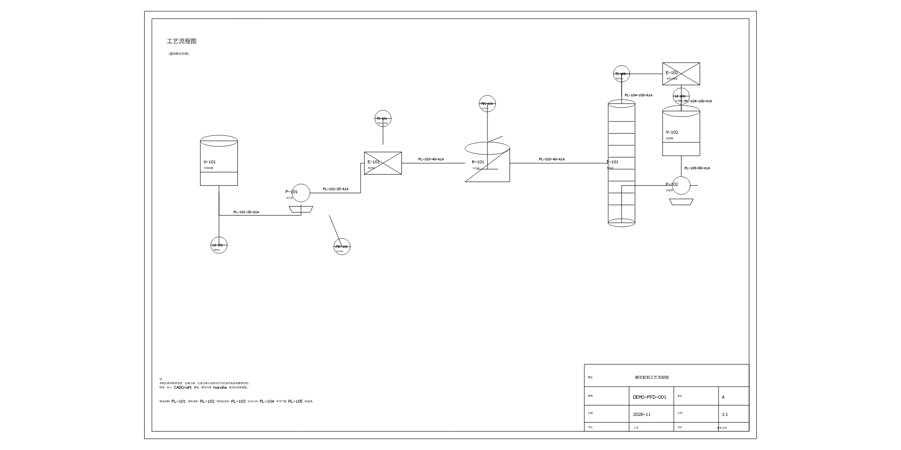

这一讲从零开始：不要求电脑里已经装过 CADCraft，也不要求会用终端。装好之后，**你只需要用自然语言交代任务，Harness 负责运行底层命令**；你负责确认范围和核对结果。

要装两个东西：

- **CADCraft App**：你用来打开图纸、目视核对；
- **cadcraft-cli**：Harness 读取和修改图纸时调用的命令行工具，和 App 同一个版本，不需要打开窗口。

只有这一讲需要动手安装。以后读图、改图都通过对话完成；课稿里的命令块是「Harness 实际执行什么」的备查记录，不是要你逐条输入。

图纸仍然只在副本上操作。真实图纸只放在本机 `~/CAD-Work/`，不进课程仓库。

### 1. 建工作目录

在「终端」里运行，或者把这句话交给 Harness：「请创建 `~/CAD-Work/` 下的 `tools`、`config`、`originals`、`work`、`preview`、`notes` 六个目录。」

```sh
mkdir -p ~/CAD-Work/{tools,config,originals,work,preview,notes}
```

目录用途：

| 目录 | 放什么 |
|---|---|
| `originals/` | 原件副本，只读，不覆盖 |
| `work/` | 修改后的新文件和中间副本 |
| `preview/` | PNG/PDF 预览 |
| `notes/` | 读图记录、台账、核对结果 |
| `tools/` | 命令行工具 |
| `config/` | CADCraft 的设置和日志，和系统设置隔离 |

### 2. 安装 CADCraft App

1. 打开 [CADCraft 官网](https://getartcraft.com/apps/cadcraft)，或直接打开 [GitHub 最新版本](https://github.com/storytold/cadcraft/releases/latest)。
2. 在 macOS 下载区找 **`cadcraft-0.20.1-macos-universal.dmg`**。`universal` 表示 Apple 芯片和 Intel 都能用；下载到更新版本时文件名里的版本号会不同。
3. 把 `SHA256SUMS.txt` 也下载到「下载」目录。校验可以交给 Harness，或自己运行：

```sh
cd ~/Downloads
shasum -a 256 cadcraft-0.20.1-macos-universal.dmg
grep cadcraft-0.20.1-macos-universal.dmg SHA256SUMS.txt
```

两行哈希必须完全一样。不一样就重新下载，不要继续安装。

4. 这一步需要手动：双击 DMG，把 **CADCraft** 拖进「应用程序」，然后在 Finder 边栏推出安装镜像。
5. 第一次打开时，如果 macOS 提示「无法验证开发者」，在 Finder 的「应用程序」里右键 CADCraft →「打开」，或到「系统设置 → 隐私与安全性」点「仍要打开」。
6. 打开后看菜单「CADCraft → 关于 CADCraft」，确认版本是 **0.20.1**。CADCraft 要求 macOS 11 或更新；系统太旧时先升级系统。

App 只用于看图和核对；下面的命令行工具才是 Harness 读取和修改图纸的入口。

### 3. 安装 cadcraft-cli

1. 在同一个 release 页面下载 **`cadcraft-cli-0.20.1-macos-universal.zip`** 和 `SHA256SUMS.txt`。
2. 校验（可以交给 Harness）：

```sh
cd ~/Downloads
shasum -a 256 cadcraft-cli-0.20.1-macos-universal.zip
grep cadcraft-cli-0.20.1-macos-universal.zip SHA256SUMS.txt
```

3. 解压到工作目录，保留里面的 LICENSE、README 和字体许可文件：

```sh
unzip -q ~/Downloads/cadcraft-cli-0.20.1-macos-universal.zip -d ~/CAD-Work/tools
chmod +x ~/CAD-Work/tools/cadcraft-cli-0.20.1-macos-universal/cadcraft-cli
```

4. 如果提示「无法打开」或「已损坏」，去掉下载隔离标记（只对这一份工具）：

```sh
xattr -d com.apple.quarantine ~/CAD-Work/tools/cadcraft-cli-0.20.1-macos-universal/cadcraft-cli
```

5. 建包装脚本，固定配置目录：

```sh
cat > ~/CAD-Work/tools/cad <<'SH'
#!/bin/sh
export CADCRAFT_CONFIG_DIR="$HOME/CAD-Work/config"
exec "$HOME/CAD-Work/tools/cadcraft-cli-0.20.1-macos-universal/cadcraft-cli" "$@"
SH
chmod +x ~/CAD-Work/tools/cad
~/CAD-Work/tools/cad --version
```

最后一行应输出 `cadcraft-cli 0.20.1`。App 和 CLI 的版本必须一致；不一致就以 release 页面为准重新下载。

### 4. 把工作区规则交给 Harness

下载课程模板 [CAD-Work-AGENTS.md](../../../assets/topics/cad/examples/CAD-Work-AGENTS.md)，放到工作区根目录并改名：

```sh
cp ~/Downloads/CAD-Work-AGENTS.md ~/CAD-Work/AGENTS.md
```

这份文件规定：`originals/` 只读、修改只写 `work/`、先给计划等你说「执行」、改前做保真门槛、改后报告命令/handle/哈希、真实图纸不外传。以后从 `~/CAD-Work` 打开 Harness 会话，它会先读这份规则。

然后**新开一个 Harness 会话，工作区选 `~/CAD-Work`**，发第一条验证提示词：

```text
请先读当前工作区的 AGENTS.md，用自己的话复述：哪些目录只读、修改写在哪里、改图前必须做什么、完成后要报告什么。
然后运行 tools/cad --version，并报告当前工作区路径。
不要修改任何文件。
```

它复述的边界应该和模板一致；如果它没有读到 AGENTS.md，先确认会话工作区是不是 `~/CAD-Work`，再重试。

### 5. 自然语言读取第一张图

把课程里的虚构示例下载到 `originals/`：[sample-pfd.dxf](../../../assets/topics/cad/examples/sample-pfd.dxf)。也可以交给 Harness 复制。

放进 `originals/` 后，在 Harness 里说：

```text
工作区是 ~/CAD-Work/。请只读 originals/sample-pfd.dxf：
1. 运行 tools/cad info 和 texts（limit 5），报告实际运行的命令；
2. 报告实体数、图层数、块数、readNotes/skipped；
3. 运行 convert，把预览写到 preview/sample-pfd.png；
4. 不要修改原件。
```

Harness 会运行下面这些命令（备查）：

```sh
~/CAD-Work/tools/cad info ~/CAD-Work/originals/sample-pfd.dxf
~/CAD-Work/tools/cad run ~/CAD-Work/originals/sample-pfd.dxf --cmd 'texts {"limit":5}'
~/CAD-Work/tools/cad convert ~/CAD-Work/originals/sample-pfd.dxf ~/CAD-Work/preview/sample-pfd.png
```

示例预期：**62 个实体、9 个图层、9 个块**，`texts` 里能看到「糖浆配制工艺流程图」。打开 `preview/sample-pfd.png`，确认中文、图框和管线都能看见。

再记下原件的哈希，后面核对修改是否动过原件时要用：

```sh
shasum -a 256 ~/CAD-Work/originals/sample-pfd.dxf
```

把输出记在 `~/CAD-Work/notes/sample-pfd-阅读.md` 开头。

<figure>
  
  <figcaption>用 CADCraft 渲染的虚构示例图；这张图只用于练习，不对应真实装置。</figcaption>
</figure>

### 6. 安装失败时先查这几件事

| 现象 | 先检查 |
|---|---|
| 哈希不一致 | 下载中断或文件不对；重新下载，别跳过校验 |
| App 打不开 | 右键「打开」；系统设置允许；macOS 是否 11 以上 |
| CLI 提示无法执行 | `chmod +x`；去掉 quarantine；确认路径是 `~/CAD-Work/tools/...` 而不是 App 内部文件 |
| `cad: command not found` | 用完整路径 `~/CAD-Work/tools/cad`，不要只写 `cad` |
| Harness 说找不到工具 | 先确认会话工作区是 `~/CAD-Work`，再让它报告 `tools/cad` 路径 |
| 中文显示成方块 | 在预览里放大看；必要时在 App 里设置字体回退，或在 `cad` 脚本里加 `CADCRAFT_FONTFALLBACK` |

### 检查清单

- [ ] `~/CAD-Work/` 六个目录已建好。
- [ ] CADCraft App 能打开，「关于」显示 0.20.1。
- [ ] CLI 和 App 版本一致。
- [ ] `~/CAD-Work/AGENTS.md` 已放好；新会话能复述规则。
- [ ] 示例 DXF 已放进 `originals/`，原件哈希已记录。
- [ ] 我只用一句自然语言就让它读出了 62 个实体、9 个图层，并导出了预览。
- [ ] 我能指出它实际运行了哪些命令。

下一讲：[让 Harness 读懂图层、块和文字](02-read-a-drawing.md)。

备查：[CADCraft 官网](https://getartcraft.com/apps/cadcraft) · [最新版本](https://github.com/storytold/cadcraft/releases/latest) · [CLI 文档](https://github.com/storytold/cadcraft/blob/main/docs/cli.md)
