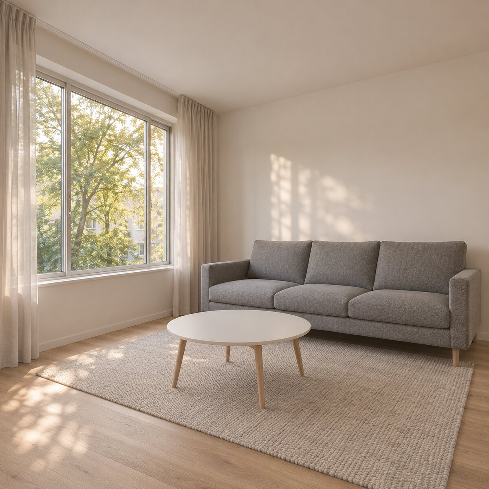
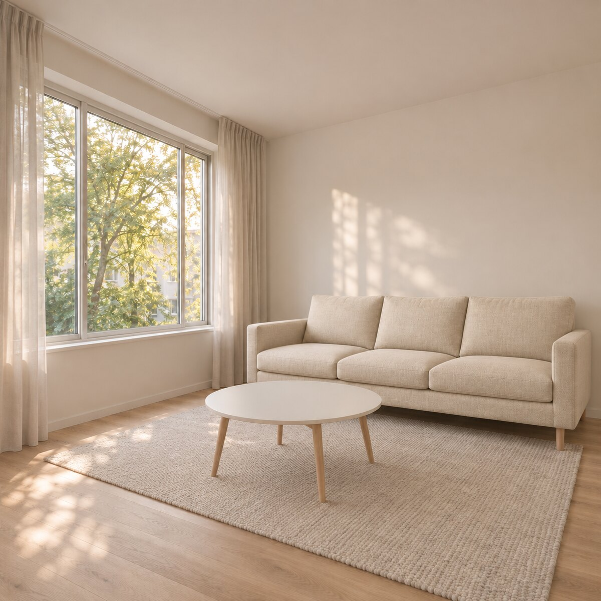
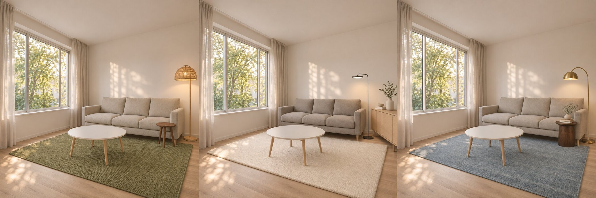

这一课只做一件事：把「用 DeepSeek Harness 生成图片」这条路跑通。先用虚构的客厅练手，再把自己的房间照片放在本机做软装方向的对比；生成图只当方向板，不当施工图，也不替代商品尺寸和材质核对。

公开课稿只用虚构房间和示例文字；真实家庭照片、门牌、快递单和家人物品只在本机使用，上传前先裁掉隐私信息。

本页的软装效果图由 **ChatGPT 生成**，只用于说明画面方向；课堂仍按下面的 Seedream 步骤生成自己的版本。

### 1. 先分清四个名字

你之前提到的「C Dream」，官方资料写作 **Seedream**（也见 SeeDream），是字节跳动的图像生成模型。和它相关的几个入口不是一回事：

| 名称 | 是什么 | 这一课怎么用 |
|---|---|---|
| **Seedream / SeeDream** | 字节跳动 Seed 团队的图像生成模型，支持文生图、参考图生图、局部编辑、组图 | 本课要调用的模型 |
| **即梦 AI** | 消费端网页/App，使用 Seedream；会员/订阅是消费级入口 | 可以自己玩，但**不能**直接给 DSH 插件当 API |
| **火山方舟 Ark** | 火山引擎的模型 API 平台：开通模型、创建 API Key、按量计费 | 本课必须走这条 |
| **dsh-image-gen** | DeepSeek Harness 的生图插件，支持 Seedream / 火山方舟 Provider | 本课安装和配置的插件 |

**关于“订阅”**：即梦会员和火山方舟 API 是两条账本。DSH 插件要的是 Ark API Key，按生成张数计费；不需要先买即梦会员。火山引擎的 Agent Plan 是另一种订阅套餐，可能含部分 Seedream Lite 额度，但先确认它是否提供可用于 `/api/v3` 的 API Key，不要把它当成图片余额。若只想在网页里随手生成，才考虑即梦会员。

### 2. 开通火山方舟和 Seedream

1. 打开[火山方舟控制台](https://console.volcengine.com/ark/region:cn-beijing)，用爸爸妈妈自己的火山引擎账号登录，按页面要求完成实名认证和开通。
2. 在模型广场或「开通管理」里找到 **Seedream**，开通要用的版本。课堂先用 **Seedream 5.0 Lite** 或 **5.0 Pro** 试，确认流程后再用 5.5 或更高分辨率。
3. 打开 [API Key 管理](https://console.volcengine.com/ark/region:cn-beijing/apiKey)，创建一把只给这台 Mac 用的 Key，命名例如 `dsh-image-gen-dad` 或 `dsh-image-gen-mom`。先停止屏幕共享，由本人复制；Key 不写进聊天、截图或课程仓库。
4. 回到控制台确认计费方式和余额。API 是按量后付费；先在预算里留一小笔练习额度，开启用量/余额提醒。
5. 记下区域和端点。图片生成默认端点是 `https://ark.cn-beijing.volces.com/api/v3`；实际以控制台和插件“拉取模型”结果为准。

当前常见模型 ID（以控制台/插件拉取结果为准）：

- `doubao-seedream-5-5-261028`：Seedream 5.5，2026-11-09 发布，API 陆续开放；
- `doubao-seedream-5-0-pro-260628`：Seedream 5.0 Pro，插件当前默认之一；
- `doubao-seedream-5-0-260128` / `doubao-seedream-5-0-lite-260128`：Seedream 5.0 Lite。

价格示例（2026-11-15 查到的官方口径，实际以下单页面为准）：Seedream 5.0 Pro 输出图不超过 236 万像素约 0.3 元/张，更大尺寸约 0.6 元/张；5.5 约 0.28 元/2K 方图编辑；Lite 更便宜。先用 Lite/1K 试构图，满意后用 Pro/5.5/2K。

### 3. 安装并启用 dsh-image-gen

1. 打开 DeepSeek Harness 左侧的「插件」面板，进入「已安装」或插件市场，搜索 `dsh-image-gen`。
2. 安装或启用后重启 Harness。插件详情页应出现「图像生成」配置表单；输入框旁也会出现生图按钮。
3. 不要照搬插件 README 里的 `--profile web` 命令到 Desktop；父母用界面安装即可。若界面找不到，先确认 Harness 版本，再让家人协助用插件管理。
4. 安装只需一次；以后升级插件后重新打开详情页检查 Provider 和模型是否还在。

### 4. 配置 Seedream Provider

在插件详情页：

1. 默认 Provider 选 **ByteDance Seedream / 火山方舟**（界面可能显示「字节 Seedream」）。
2. 填入第 2 步创建的 API Key。
3. Endpoint / Base URL 保持默认；若为空，填 `https://ark.cn-beijing.volces.com/api/v3`。
4. 模型先填 `doubao-seedream-5-0-pro-260628`，或点「拉取模型」后选可用的 5.5 / 5.0 Lite。
5. 点「测试连接」。通过后再点「拉取模型」核对模型列表；失败先看第 8 步的排错。
6. 设置输出格式（PNG/JPEG）、水印开关和保存工作区。水印是否可关以模型和条款为准；课堂先用默认。
7. 保存后，回到会话输入框旁确认 Provider 是 Seedream，不要误用 ChatGPT 订阅通道。

密钥只保存在本机 DSH 凭据里；不要为了“方便”把 Key 写进课稿、仓库、聊天或截图。

### 5. 第一张图：虚构客厅

先用一张虚构房间练提示词，不要上传真实家庭照片。要求写明：房间、固定不动的元素、要换的软装、光线、镜头和比例。

```text
请生成一张约 20 平方米客厅的软装示意：浅橡木地板，米白色墙，左侧落地窗，午后自然光；现有灰色布艺三人沙发、白色圆形茶几。请只把沙发换成浅米色亚麻三人沙发，增加胡桃木边柜和橄榄绿地毯；保留窗、墙、地板、光线和拍摄角度不变，其他家具不要移动。真实照片感，24mm 广角，1:1，不要添加文字。
```


<figure>

<figcaption>示例：虚构客厅的初始软装方向，先固定房间结构再换软装（ChatGPT 生成）。</figcaption>
</figure>

生成后先看四件事：

- 房间结构和窗/墙/地板有没有被改掉；
- 沙发、边柜、地毯是不是你要的方向；
- 光线、镜头角度是否还能和原房间对上；
- 画面里有没有乱码文字或多余物件。

不要一次要求“全部重新设计”。软装对比要控制变量，否则看不出是哪一件东西变了。

### 6. 在原图上改：只换一处

打开 `画廊 → 工作台`，或在画布/图库里选中刚生成的图：

1. 点「继续编辑（垫图）」或把图拖进画布，作为参考图。
2. 用画笔圈出要改的区域（例如沙发），或在提示词里明确位置。
3. 发一条只改一处的修改意见：

```text
只改左侧沙发：换成浅米色亚麻三人沙发；保留窗帘、地板、光线、镜头角度、其他家具和房间结构不变。不要把整张图重新设计，不要添加文字。
```


<figure>

<figcaption>示例：只把沙发换成浅米色亚麻三人沙发，窗、墙、地板、茶几和光线保持不变（ChatGPT 生成）。</figcaption>
</figure>

4. 生成后对比新旧两版，满意就保存为新版本；不满意就退回上一版再改，不要覆盖原图。
5. 再试一次“只换地毯”或“只换落地灯”，每次都只改一个变量。

如果插件支持画布选区，优先圈出要改的地方再发指令；选区能让模型更清楚“只改这里”。如果当前通道的图生图不稳定，就先退回“文字重生成”，但把固定条件写得更具体。

### 7. 软装选品：三套方案与核对

同一房间一次生成三套方向，每套只改变软装组合：

```text
同一间客厅，保留墙、窗、地板、主沙发、光线和镜头角度不变，分别生成三套软装方向：
A：橄榄绿地毯 + 藤编落地灯 + 胡桃木边几；
B：米色羊毛地毯 + 黑色细杆落地灯 + 浅木边柜；
C：蓝灰地毯 + 黄铜落地灯 + 深色边几。
每套单独一张图，真实照片感，1:1，不要添加文字。
```


<figure>

<figcaption>示例：三套软装方向，只比较颜色和材质；尺寸仍以商品页为准（ChatGPT 生成）。</figcaption>
</figure>

拿去淘宝/店里选品时：

- 先量墙面、沙发、柜子和通道尺寸，再看商品尺寸；生成图不保证比例。
- 用生成图比较颜色、材质和风格，商品页的尺寸、材质、色差、安装方式和退货政策以商家为准。
- 不要根据生成图判断“放得下”；放不下是尺寸问题，不是画面问题。
- 真实房间照片只在本机使用；上传前裁掉门牌、家人照片、快递单等隐私信息；公开课稿只放虚构房间。
- 生成图只作方向板，最终以实物、样板和小样为准。

### 8. 费用、隐私和故障排查

**费用**

- 按生成张数计费；先 Lite/1K 试构图，再用 Pro/5.5/2K 做最终图。
- 在火山方舟控制台看用量、余额和账单；设预算提醒，避免一次批量生成过多。
- 5.0 Pro 输出图 ≤236 万像素约 0.3 元/张，更大尺寸约 0.6 元/张；5.5 约 0.28 元/2K 编辑；以控制台为准。

**隐私**

- API Key 不截图、不进聊天、不进仓库；只放本机 DSH 凭据。
- 真实家庭照片不上传公开仓库；按火山方舟条款处理图片。
- 课堂投屏时先停共享再粘贴 Key。

**排错**

| 现象 | 先检查 |
|---|---|
| 401/403 | Key 是否复制完整；模型是否开通；账号是否欠费；实名/区域是否符合 |
| 404 模型不存在 | 模型 ID 是否过期；点「拉取模型」选当前 ID；5.5 是否已对该账号开放 |
| 429 | 触发限流；等一会儿，减少并发/批量 |
| 测试连接失败 | Endpoint 是否 `/api/v3`；Key 是否属于当前区域；网络是否可访问火山方舟 |
| 生成成功但看不到图 | 图库/工作区保存位置；Provider 是否选对；刷新或重开插件 |
| 中文小字乱码 | 减少画面文字；重要文字后期另加，不依赖模型写小字 |
| 改图改得太多 | 提示词写“只改…、保留…”，用选区圈定；降低一次修改数量 |

### 9. 验收清单

- [ ] 能说清 Seedream、即梦、火山方舟和 dsh-image-gen 的区别。
- [ ] 火山方舟账号已开通 Seedream，API Key 只保存在本机。
- [ ] dsh-image-gen 已安装并启用，Provider 选 ByteDance Seedream / 火山方舟。
- [ ] 「测试连接」通过，「拉取模型」能看到可用模型。
- [ ] 用虚构客厅生成至少一张图，能说出模型、尺寸和大约费用。
- [ ] 在原图上只改一处（沙发/地毯/灯），保存新版本，原图还在。
- [ ] 生成三套软装方向，能说清哪些是画面方向、哪些必须去商品页核对尺寸和材质。
- [ ] 真实照片没有上传公开仓库；API Key 没有进截图、聊天或课稿。

#### 备查

- [Seedream 5.5 教程](https://docs.volcengine.com/docs/ark/seedream-5-5?lang=zh)
- [Seedream 5.0 Pro 教程](https://docs.volcengine.com/docs/ark/seedream-5-0-pro?lang=zh)
- [图片生成教程](https://docs.volcengine.com/docs/ark/image-generation-tutorial?lang=zh)
- [模型价格](https://docs.volcengine.com/docs/ark/model-pricing?lang=zh)
- [API Key 管理](https://console.volcengine.com/ark/region:cn-beijing/apiKey)
- [dsh-image-gen 插件](https://github.com/shanliuling/dsh-image-gen)
