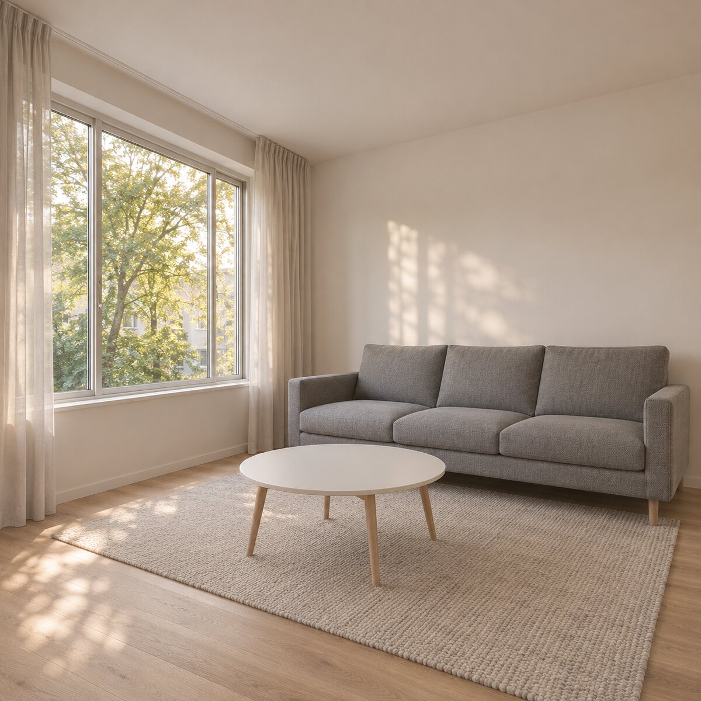
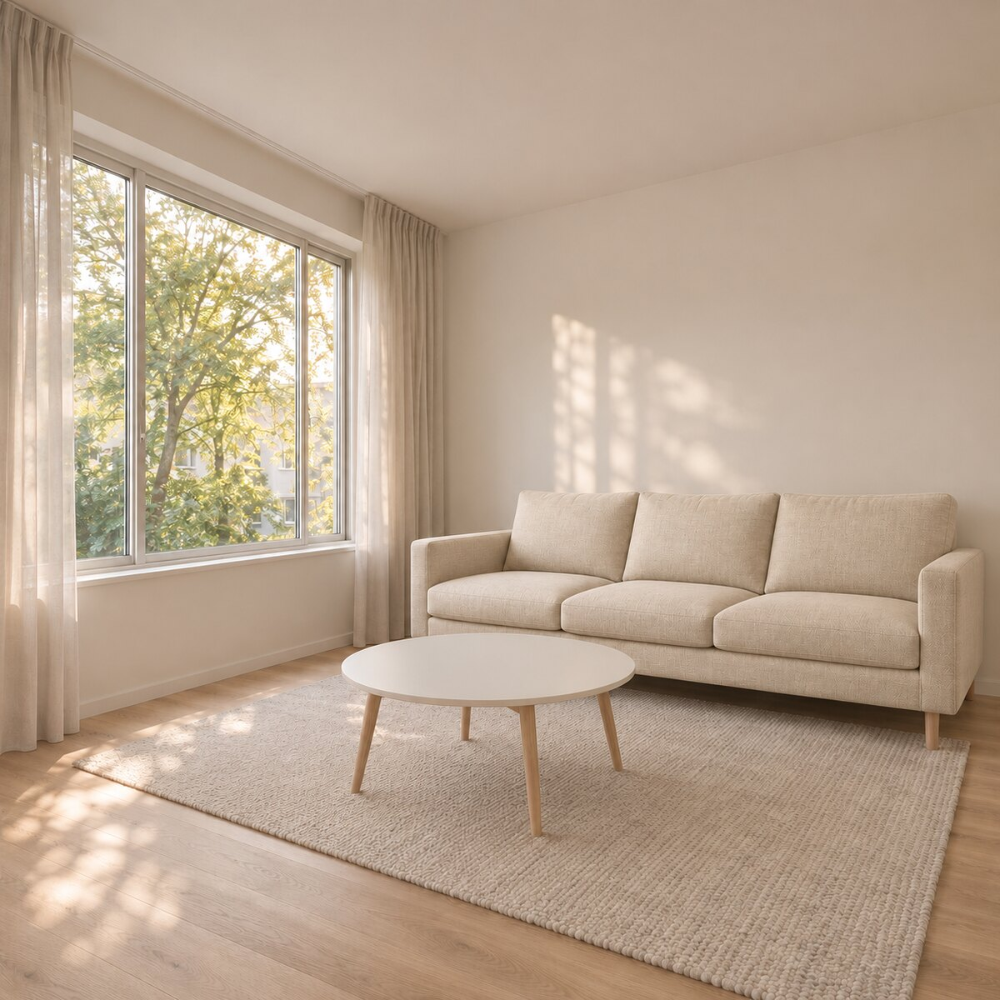
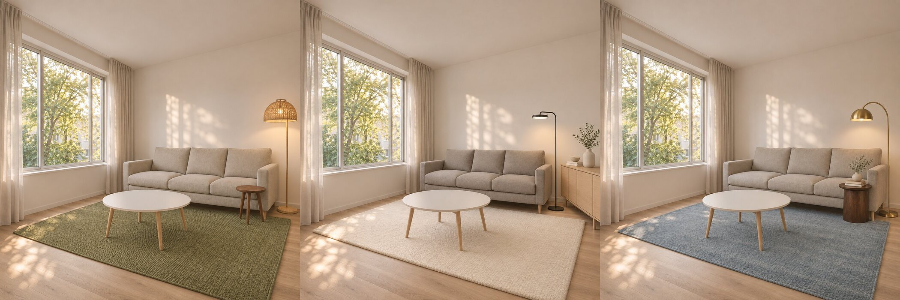

这一讲接着「配置 Seedream 和 dsh-image-gen」，默认链路已经跑通。今天用虚构客厅练构图、局部修改和软装方向，不处理真实家庭照片。

本页的软装效果图由 **ChatGPT 生成**，只用于说明画面方向；课堂仍按下面的 Seedream 步骤生成自己的版本。

### 1. 第一张图：虚构客厅

先用一张虚构房间练提示词，不要上传真实家庭照片。要求写明：房间、固定不动的元素、要换的软装、光线、镜头和比例。

```text
请生成一张约 20 平方米客厅的软装示意：浅橡木地板，米白色墙，左侧落地窗，午后自然光；现有灰色布艺三人沙发、白色圆形茶几。请只把沙发换成浅米色亚麻三人沙发，增加胡桃木边柜和橄榄绿地毯；保留窗、墙、地板、光线和拍摄角度不变，其他家具不要移动。真实照片感，24mm 广角，1:1，不要添加文字。
```


<figure>

<figcaption>示例：虚构客厅的初始软装方向，先固定房间结构再换软装（ChatGPT 生成）。</figcaption>
</figure>

生成后先看四件事：

- 房间结构和窗/墙/地板有没有被改掉；
- 沙发、边柜、地毯是不是你要的方向；
- 光线、镜头角度是否还能和原房间对上；
- 画面里有没有乱码文字或多余物件。

不要一次要求“全部重新设计”。软装对比要控制变量，否则看不出是哪一件东西变了。

### 2. 在原图上改：只换一处

打开 `画廊 → 工作台`，或在画布/图库里选中刚生成的图：

1. 点「继续编辑（垫图）」或把图拖进画布，作为参考图。
2. 用画笔圈出要改的区域（例如沙发），或在提示词里明确位置。
3. 发一条只改一处的修改意见：

```text
只改左侧沙发：换成浅米色亚麻三人沙发；保留窗帘、地板、光线、镜头角度、其他家具和房间结构不变。不要把整张图重新设计，不要添加文字。
```


<figure>

<figcaption>示例：只把沙发换成浅米色亚麻三人沙发，窗、墙、地板、茶几和光线保持不变（ChatGPT 生成）。</figcaption>
</figure>

4. 生成后对比新旧两版，满意就保存为新版本；不满意就退回上一版再改，不要覆盖原图。
5. 再试一次“只换地毯”或“只换落地灯”，每次都只改一个变量。

如果插件支持画布选区，优先圈出要改的地方再发指令；选区能让模型更清楚“只改这里”。如果当前通道的图生图不稳定，就先退回“文字重生成”，但把固定条件写得更具体。

### 3. 软装选品：三套方案与核对

同一房间一次生成三套方向，每套只改变软装组合：

```text
同一间客厅，保留墙、窗、地板、主沙发、光线和镜头角度不变，分别生成三套软装方向：
A：橄榄绿地毯 + 藤编落地灯 + 胡桃木边几；
B：米色羊毛地毯 + 黑色细杆落地灯 + 浅木边柜；
C：蓝灰地毯 + 黄铜落地灯 + 深色边几。
每套单独一张图，真实照片感，1:1，不要添加文字。
```


<figure>

<figcaption>示例：三套软装方向，只比较颜色和材质；尺寸仍以商品页为准（ChatGPT 生成）。</figcaption>
</figure>

拿去淘宝/店里选品时：

- 先量墙面、沙发、柜子和通道尺寸，再看商品尺寸；生成图不保证比例。
- 用生成图比较颜色、材质和风格，商品页的尺寸、材质、色差、安装方式和退货政策以商家为准。
- 不要根据生成图判断“放得下”；放不下是尺寸问题，不是画面问题。
- 真实房间照片只在本机使用；上传前裁掉门牌、家人照片、快递单等隐私信息；公开课稿只放虚构房间。
- 生成图只作方向板，最终以实物、样板和小样为准。

### 4. 验收清单

- [ ] 用虚构客厅生成至少一张图，能说出模型、尺寸和大约费用。
- [ ] 在原图上只改一处（沙发/地毯/灯），保存新版本，原图还在。
- [ ] 生成三套软装方向，能说清哪些是画面方向、哪些必须去商品页核对尺寸和材质。
- [ ] 真实照片没有上传公开仓库；API Key 没有进截图、聊天或课稿。

#### 备查

- [Seedream 5.5 教程](https://docs.volcengine.com/docs/ark/seedream-5-5?lang=zh)
- [Seedream 5.0 Pro 教程](https://docs.volcengine.com/docs/ark/seedream-5-0-pro?lang=zh)
- [图片生成教程](https://docs.volcengine.com/docs/ark/image-generation-tutorial?lang=zh)
- [模型价格](https://docs.volcengine.com/docs/ark/model-pricing?lang=zh)
- [API Key 管理](https://console.volcengine.com/ark/region:cn-beijing/apiKey)
- [dsh-image-gen 插件](https://github.com/shanliuling/dsh-image-gen)
