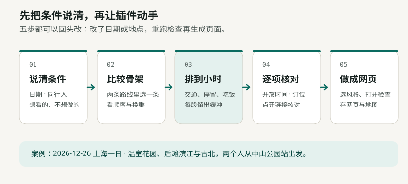

这一讲不排到小时，也不做网页。先把一次出门说成插件能用的条件，再从两条路线骨架里选一条。案例用的是 2026 年 12 月 26 日、从中山公园站出发的上海一日，两个人的行程。

<figure>

<figcaption>示意图：案例走的五步。每一步都能回头改，改完再重跑后面的检查。</figcaption>
</figure>

### 1. 先写一张条件卡

动手前把这几项写下来，越具体越好。插件一次问清，就不用来回补。

| 条件 | 案例里的写法 |
|---|---|
| 日期 | 2026 年 12 月 26 日，周六 |
| 同行 | 2 位成人，从中山公园站出发，晚上回中山公园站 |
| 想看的 | 室内植物园；下午能坐下喝咖啡；晚饭吃日料 |
| 不想做的 | 排太满、走太远、临时找店 |
| 吃饭 | 中午江南菜，晚上日料，两餐都想订位 |
| 体力 | 一天走路控制在 6 公里左右，中间能坐 |
| 预算 | 门票加两餐，不算购物 |

先完成[「AI 入门与基础」第 2 讲](../ai/02-harness-setup.md)，确认「境内旅行规划 · Trip Planner CN」已经安装并启用。插件入口和按钮名称以自己电脑上的版本为准。

### 2. 让插件先给两条骨架

这一步只要路线，不要完整行程。骨架阶段改起来最便宜。

```text
这个周六（2026 年 12 月 26 日）我们两个人想在上海玩一天，从中山公园地铁站出发，晚上还回中山公园站。
我们想看室内植物园，中午吃江南菜，下午找个地方坐下喝咖啡，晚上吃日料；不想走太赶，一天走路控制在 6 公里左右。
请先用行程规划插件给我 2 条可比较的一日路线骨架：每条写清顺序、换乘方式、每段大概用时、午饭和晚饭落在哪里，并说明适合谁、缺点是什么。
先不要排到小时，也不要生成网页。查不到的开放时间或订位信息写「待核对」，不要编。
```

预期结果是两条能并排看的骨架，外加一句推荐。允许它做的事只有查资料和排顺序：不订位、不付款、不生成网页。如果它直接给了一张完整时间表，就让它退回来，只保留两条骨架再比较。

### 3. 用三点比较，自己选

案例里的两条骨架是这样比的：

| | 方案 A（后来选的） | 方案 B |
|---|---|---|
| 顺序 | 温室 → 滨江 → 黄金城道 → 鮨贯 | 温室 → 上生新所 → 古北小店 → 鮨贯 |
| 换乘 | 地铁一次换乘，古北那段改打车 | 地铁两次换乘，下午更像城市漫步 |
| 走路 | 约 5.2 公里（街道约 6.8），有一段 2.2 公里用打车 | 约 6 公里，咖啡店能坐更久 |
| 适合 | 想少折腾、以室内为主 | 想多逛街区、不介意换乘 |

最后选 A，理由有三条：温室和滨江都在后滩，换乘少；下午最冷的时候在室内；晚饭位置固定，不用临时找店。AI 的推荐只是参考，体力和口味以同行的人为准。

### 4. 核对骨架里每个地点

骨架里的名字都要真的存在、真的开门。案例里逐项核到的是这些（2026-11-20 查证，出发前一周还要再看一次）：

| 地点 | 要核对什么 | 案例结果 |
|---|---|---|
| 上海温室花园 | 开放时间、闭馆日、要不要预约 | 09:00–21:00，20:30 停止入园；周一闭馆；周末票 ¥128，官方小程序预约 |
| 江南晓宴（世博文化公园店） | 午市时间、能不能订位 | 11:00–14:00，订 12:50 两位 |
| Floane Cafe / 黄金城道 | 开到几点、周末有没有座位 | 黄金城道 743 号 101（古北路入口），08:30–18:00，下午去，先到先坐 |
| 鮨贯（新虹桥商厦二楼） | 晚市时间、订位、位置 | 17:30–22:00，订 18:00 两位；仙霞路 158 号 |

核对时优先看景区或餐厅自己的渠道，其次看地图上的营业信息。网上的旧攻略经常还写着几年前的营业时间，别直接抄。

### 5. 把选择说回去

选定后只用一句话交代，让插件进入下一步：

```text
就按方案 A。请继续排到小时，先给时间线草稿，不要生成网页。
```

- [ ] 条件卡写完了，日期、同行、想看的、不想做的都在。
- [ ] 拿到了两条可比较的骨架，能说出各自适合谁。
- [ ] 选定了一条，并写下三条理由。
- [ ] 骨架里每个地点都核对过存在、开放时间和订位方式。
- [ ] 把「就按方案 A」说回去了。
