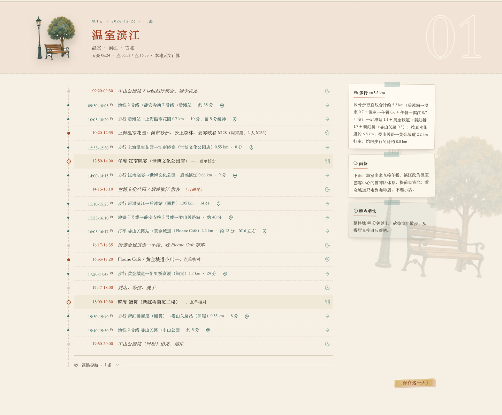

骨架只说明先后顺序，还不说明几点出门、每段要多久。这一讲把它排到小时，并且把「估算」和「已核实」分开写。案例排完是 09:20 在中山公园站集合、20:00 回到中山公园站的一天。

### 1. 让它排到小时

```text
就按方案 A 继续。请把这一天排到小时：写清每段交通、停留时长、吃饭时间、缓冲，标出哪些是估算、哪些已经核实。
我们坐地铁，不赶时间；午饭想在 12:50 左右，晚饭 18:00，两餐都会提前订位。
请同时给出步行总里程和每段用时，并说明哪几段需要我自己点开地图核对。
不要替我下单或订位；查不到的信息写「出发前再查」。
```

拿到时间线后先看三件事：每段之间有没有缓冲、温室和吃饭的时段对不对、最后一班地铁之前能不能回到起点。案例里每段交通后面都留了 5–10 分钟，滨江散步标成「可跳过」。

### 2. 分清「估算」和「已核实」

同一张时间表里，数字的可信程度不一样。案例里是这样标的：

| 项目 | 案例里的数字 | 性质 |
|---|---|---|
| 温室开放时间 | 09:00–21:00，20:30 停止入园，周一闭馆 | 已核实（2026-11-20，出发前一周再看公告） |
| 温室门票 | 周末票 ¥128，官方小程序预约 | 已核实票价，当天余票另看 |
| 地铁 中山公园→后滩 | 约 35 分 | 估算，点链接核对 |
| 地铁 后滩→娄山关路 | 约 40 分 | 估算，点链接核对 |
| 园外步行 | 直线合计约 5.2 km，按街道约 6.8 km | 估算 |
| 鮨贯晚市 | 17:30–22:00 | 已核实，订位时再确认 |

走路里程最容易低估：坐标算的是直线，真实街道会多两到三成。案例按街道算是 6.8 km，比条件卡里的 6 km 略多，所以把滨江那 55 分钟留成随时可砍的一段。

<figure>

<figcaption>案例页里的一天：交通、停留和缓冲在同一张时间线上，每一段旁边的箭头能打开地图。实际操作结果截图。</figcaption>
</figure>

### 3. 点开链接核对关键换乘

不用每段都点，但载重的那几段一定要看。案例里点开核对的是这三段：

1. **中山公园 → 后滩**：2 号线到静安寺换 7 号线。静安寺换乘通道比较长，留 8–10 分钟，别按「同站台换乘」算。
2. **后滩 → 娄山关路**：7 号线回静安寺换 2 号线，和上午方向相反，注意别坐过站；出站后按打车点的定位上车。
3. **娄山关路 → 黄金城道**：2.2 公里，案例改成打车，12 分钟左右；打不到车就走到延安西路坐公交，或者直接砍掉咖啡。

看链接时顺便确认出口编号和打车上下车点。地图上的「预计时间」也分驾车、公交、步行，别把驾车时间当成地铁时间。

### 4. 核对开放时间、预约和订位

- **温室**：周一闭馆，周末 20:30 停止入园。在微信「上海世博文化公园」小程序买周末票并预约，二维码截图存相册；60 岁以上有没有优惠以小程序当天规则为准。
- **两餐**：江南晓宴午市 11:00–14:00，订 12:50；鮨贯晚市 17:30–22:00，订 18:00。订位时顺口问一句当天是否营业。
- **咖啡**：Floane Cafe 约 08:30–18:00，下午去，周末座位紧，先到先坐。
- **天气**：出发前一周看[中央气象台](http://www.nmc.cn/)的预报和预警；12 月下旬上海日落约 17:00，户外段尽量排在 16:30 前。

### 5. 写雨天备选和「晚了砍哪段」

出门前一定会有变化，先写好两句，到时候不用现场商量：

- **雨天**：温室出来直接吃午饭，滨江改成温室游客中心的咖啡区休息，提前去古北，黄金城道只走到咖啡店。
- **晚了**：整体晚 40 分钟以上，砍掉滨江散步，从餐厅直接回后滩站。

案例页把这两句放在一天右侧的小卡片里，出门前扫一眼就能找到。

- [ ] 时间线排到了小时，每段交通后面有缓冲。
- [ ] 每个数字都标了「已核实」「估算」或「出发前再查」。
- [ ] 点开核对过三段关键换乘，知道出口和换乘通道要走多久。
- [ ] 温室门票和两餐都已预约或订位，二维码和订位记录存好。
- [ ] 写好了雨天备选和「晚了砍哪段」。
