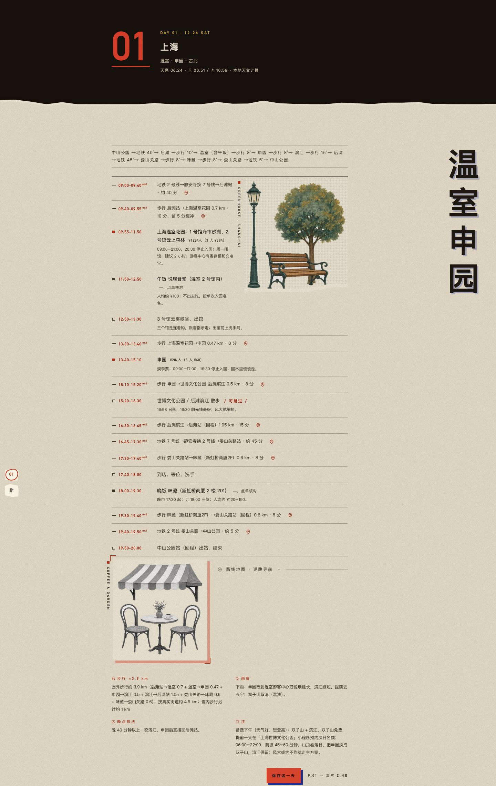

第三轮：你说做成网页；AI 选 zine 模板渲染；你检查、保存、分享。到这一步，行程内容已经定了，网页只是把它变成家人能打开的一页。

**这一讲谁做什么**

| 谁 | 这一步做什么 | 交回什么 |
|---|---|---|
| **你** | 说做成网页；打开检查；保存三样；决定发给谁 | 网页、KML、ICS |
| **AI（DeepSeek）** | 选 zine 模板、渲染、跑检查、导出 KML 和 ICS | 三个文件 |
| **插件（脚本）** | 渲染和页面检查；不发布、不替你发给家人 | — |

### 1. 你发第三段 prompt

```text
行程确认。请做成网页，用 zine 模板，中文。
页面里要有：封面、一天的时间线、每段地图链接、行前清单、雨天和晚点方案，
以及下午备选的「注」卡。
生成后告诉我文件在哪里，并一起给我离线地图（KML）和日历提醒（ICS）。
做好后先自己检查有没有空白、占位文字或打不开的链接，再让我打开看。
```

### 2. AI 在做：渲染 zine、出三个文件

> **AI 在做**：用 zine 模板渲染；把备选下午写进「注」卡；跑页面检查；导出 KML 和 ICS。
>
> **它不做的**：不发布到网上、不替你发给家人、不预订。
>
> **它交回**：一个网页、一个 KML、一个 ICS。

### 3. 你打开检查三处

1. **封面**：日期、起点、路线能不能一眼读完。
2. **一天**：每段的时间和交通对不对；点两三个地图链接，看是否落在正确的地点。
3. **注卡**：下午的备选（双子山 + 滨江）在不在，写没写清预约和体力。

<figure>

<figcaption>zine 版的封面：钴蓝纸面、竖排标题和撕纸边的照片。实际操作结果截图。</figcaption>
</figure>

再用手机宽度看一遍：字有没有被切掉，按钮能不能点。zine 的竖排标题和贴纸在窄屏上会重新排，别只看电脑。

<figure>

<figcaption>zine 版的一天：章节头、竖排标题、细线时间线，右下角是下午备选的「注」卡。实际操作结果截图。</figcaption>
</figure>

### 4. 你保存三样东西

| 文件 | 用途 | 怎么用 |
|---|---|---|
| 网页（`.html`） | 发给家人，手机浏览器直接打开 | 单独一个文件，不依赖网络；也可以先生成长图 |
| 离线地图（`.kml`） | 把当天所有点导入地图 App | 高德、百度或 Organic Maps 导入收藏点，信号差时备用 |
| 日历提醒（`.ics`） | 预约、订位、出发前复核 | 双击导入日历，提醒按日期出现 |

案例的三样文件都在这里：

- [打开 zine 案例网页](../../../assets/topics/trip-planning/examples/shanghai-day/trip-zine.html)
- [下载行程计划（JSON）](../../../assets/topics/trip-planning/examples/shanghai-day/plan.geo.json)
- [下载离线地图（KML）](../../../assets/topics/trip-planning/examples/shanghai-day/trip.kml)
- [下载日历提醒（ICS）](../../../assets/topics/trip-planning/examples/shanghai-day/gates.ics)

自己的真实行程放在本机一个固定文件夹，不推到公开仓库；课程里的案例才放在 `assets/topics/trip-planning/examples/`。

### 5. 三条复盘

1. **哪里估错了**：案例初稿按 5 公里排，实际园外 3.9 公里、街道 4.9 公里，所以滨江留成可砍的一段。
2. **出发前还要再查什么**：温室有没有临时闭馆，味藏订位是否确认，双子山还约不约得到。
3. **下次少问什么**：把“3 个人、人均 150、等位 15 分钟、午饭在馆内”写进条件卡，下次直接复用。

- [ ] 用 zine 模板生成了网页，三处都打开看过。
- [ ] 手机上又看了一遍，竖排标题和注卡没有被切。
- [ ] 网页、KML 和 ICS 三样都保存好了。
- [ ] 真实行程放在本机目录，没有推到公开仓库。
- [ ] 写下了三条复盘。
